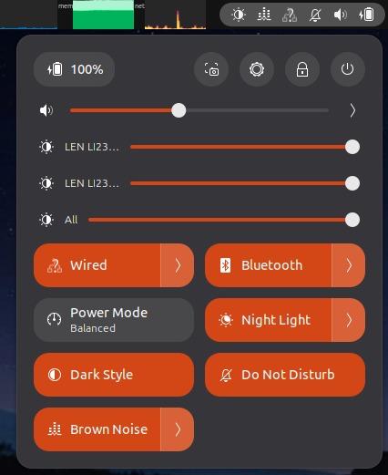
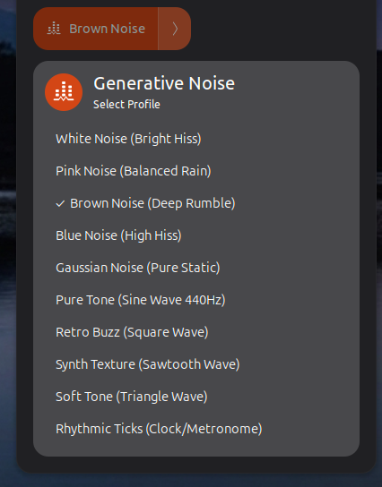
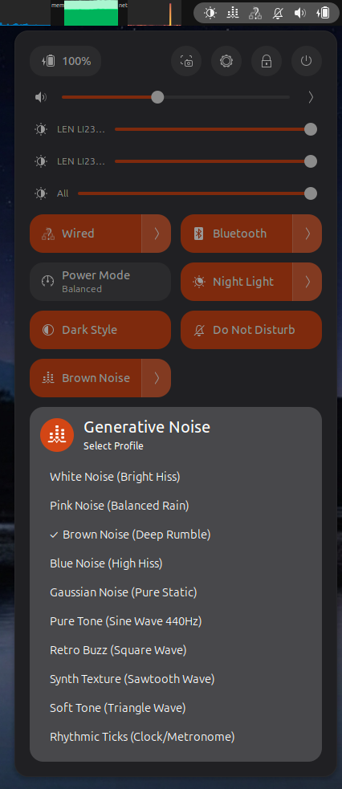
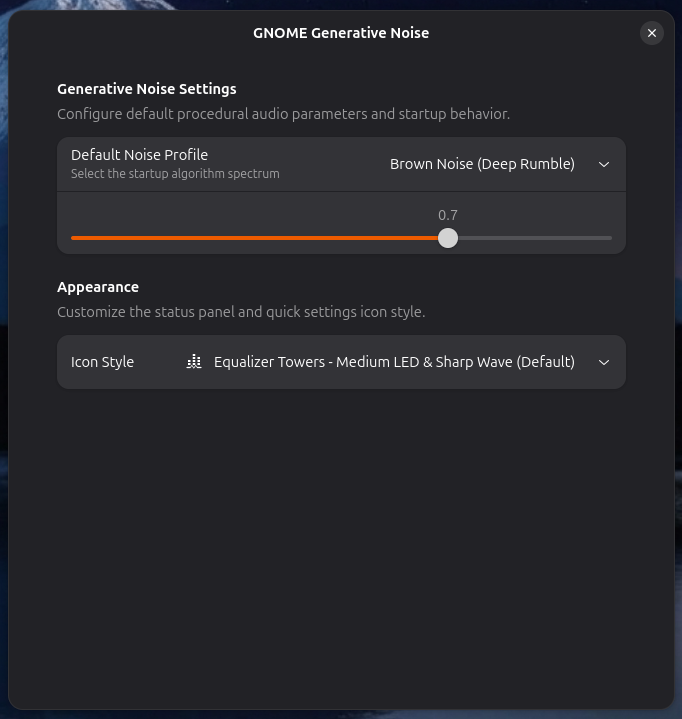

# GNOME Generative Noise for GNOME Shell

[](https://github.com/kyleabaker/gnome-generative-noise/actions)

[](https://github.com/kyleabaker/gnome-generative-noise/releases)
[](https://www.gnu.org/licenses/gpl-3.0)

**GNOME Generative Noise** is a high-performance, 100% offline ambient noise extension for GNOME Shell. Unlike traditional audio players that rely on pre-recorded audio files prone to distracting repeating seams or clicks, this extension uses **procedural mathematical synthesis** via GStreamer to generate infinitely long, non-repeating ambient soundscapes on the fly.

Designed specifically for the modern GNOME desktop, it integrates natively into the **Quick Settings panel** with a toggle and dropdown submenu for instant one-click playback control and profile selection.

---

## Screenshots

[](https://www.kyleabaker.com/goodies/linux/gnome-generative-noise-for-gnome-shell/)
[](https://www.kyleabaker.com/goodies/linux/gnome-generative-noise-for-gnome-shell/)

[](https://www.kyleabaker.com/goodies/linux/gnome-generative-noise-for-gnome-shell/)
[](https://www.kyleabaker.com/goodies/linux/gnome-generative-noise-for-gnome-shell/)

---

## Features

- **True Procedural Generation:** Uses mathematical oscillators (`audiotestsrc`) to produce continuous, non-looping audio streams. Zero disk space required for audio assets.
- **Extended Noise & Tone Library:** Instantly switch between ten distinct algorithmic sound profiles:
  - **White Noise:** Bright, equal-energy hiss (like classic static).
  - **Pink Noise:** Balanced, octave-equal hiss (softer, like heavy rainfall).
  - **Brown Noise:** Deep, rolling rumble (like a distant waterfall or heavy thunder).
  - **Blue Noise:** High-frequency boosted hiss.
  - **Gaussian Noise:** Pure statistical static.
  - **Pure Tone (Sine Wave 440Hz):** Clean fundamental tone.
  - **Retro Buzz (Square Wave):** Sharp 8-bit style buzz.
  - **Synth Texture (Sawtooth Wave):** Rich harmonic sweep.
  - **Soft Tone (Triangle Wave):** Mellow rounded tone.
  - **Rhythmic Ticks (Clock/Metronome):** Steady rhythmic pulse.
- **Quick Settings Integration:** A native `QuickMenuToggle` in the GNOME Quick Settings panel — click the toggle to start or stop playback, open the submenu to select a profile.
- **Customizable Status Icons:** Choose from multiple icon styles via the preferences window.
- **Persistent Settings (GSettings):** Remembers your preferred noise profile, volume, and icon style across sessions.
- **Native Libadwaita Preferences Window:** Clean, HIG-compliant settings panel accessible right from the GNOME Extensions app.
- **Suspend & Sleep Intelligence:** Automatically pauses audio when your system enters sleep/suspend, and safely restores state upon wake.
- **Process Watchdogs:** Actively monitors background GStreamer processes to prevent zombie pipelines or UI desynchronization.

---

## Requirements

- **GNOME Shell:** Version 45, 46, 47, 48, 49, 50, or 51.
- **System Dependencies:** GStreamer core and CLI tools (`gst-launch-1.0`).

### Installing System Dependencies (Ubuntu / Debian)

Before installing the extension, ensure GStreamer tools are present on your system:

```bash
sudo apt update
sudo apt install gstreamer1.0-tools gstreamer1.0-plugins-good
```

---

## Installation Guide

### Manual Installation

1. Clone or download this repository into your local GNOME Shell extensions directory:
   ```bash
   mkdir -p ~/.local/share/gnome-shell/extensions/gnome-generative-noise@kyleabaker.github.com
   ```
2. Place the following required files into that directory:
   - `metadata.json`
   - `extension.js`
   - `stylesheet.css`
   - `prefs.js`
   - `schemas/org.gnome.shell.extensions.com.github.kyleabaker.gnome-generative-noise.gschema.xml`

3. Compile the GSettings schema so GNOME recognizes your persistent preferences:

   ```bash
   glib-compile-schemas ~/.local/share/gnome-shell/extensions/gnome-generative-noise@kyleabaker.github.com/schemas/
   ```

4. **Restart GNOME Shell:**
   - **On X11:** Press `Alt + F2`, type `r`, and press Enter.
   - **On Wayland:** Log out and log back in.

5. Enable the extension using the **Extensions** app or via terminal:
   ```bash
   gnome-extensions enable gnome-generative-noise@kyleabaker.github.com
   ```

---

## Usage Guide

- **Toggle Playback:** Click the Generative Noise toggle in the Quick Settings panel to start or stop sound generation. A status indicator icon appears in the top bar during playback.
- **Select Profile:** Open the toggle's submenu to choose from any of the ten available noise and tone profiles — the active profile is marked with a checkmark.
- **Configure Defaults:** Open the **Extensions** app, locate _GNOME Generative Noise_, and click the gear/preferences icon to adjust default startup profiles, output volume, and icon style via the Libadwaita settings window.

---

## Architecture & Security

- **Secure Process Spawning:** Uses `Gio.Subprocess` with array-based argument vectors rather than raw shell string evaluation, providing immunity to command injection vulnerabilities.
- **Strict Memory Hygiene:** All signal listeners, GSettings connections, and D-Bus proxies are explicitly disconnected and cleaned up upon extension disable, ensuring zero memory leaks.

---

## Development Quick Start

### Quick Install (One-Liner)

If you have `curl` and `jq` installed, you can install the latest release directly without cloning the repository:

```bash
curl -s https://api.github.com/repos/kyleabaker/gnome-generative-noise/releases/latest \
| jq -r '.assets[] | select(.name | endswith(".zip")) | .browser_download_url' \
| xargs curl -L -o extension.zip \
&& gnome-extensions install --force extension.zip \
&& rm extension.zip
```

> **Note:** After running this, you must **restart GNOME Shell** (Alt+F2, type `r`, Enter) or log out/in for the extension to appear in your list. Then, enable it via the "Extensions" app.

### Contributions

Got ideas, suggestions, or found a bug?  
[Open an issue on GitHub](https://github.com/kyleabaker/gnome-generative-noise/issues) or submit a **pull request**.

### Build from Source

To build and install this extension from source, ensure you have the standard build utilities and GNOME development tools installed.

#### 1. Install Build Tools

- **Ubuntu/Debian:** `sudo apt install build-essential libglib2.0-bin zip jq npm`
- **Fedora:** `sudo dnf install make gcc glib2 zip jq npm`
- **Arch:** `sudo pacman -S base-devel glib2 zip jq npm`

#### 2. Compilation & Installation

Run these commands from the project root directory:

- **Build the package:** Creates a distributable `.zip` file in the `dist/` folder.
  ```bash
  make -f tools/Makefile
  ```
- **Install locally:** Compiles schemas and deploys the extension to your local GNOME folder.
  ```bash
  make -f tools/Makefile install
  ```

#### 3. Activate the Extension

GNOME requires a session refresh to detect new local extensions:

- **Xorg:** Press `Alt` + `F2`, type `r`, and press `Enter`.
- **Wayland:** Log out and log back in.
- **Enable:** Use the **Extensions** app or run:
  ```bash
  gnome-extensions enable gnome-generative-noise@kyleabaker.github.com
  ```

### Release Process

To share a new version on the GitHub Releases tab:

1.  **Update Version:** Increment the `version` field in `metadata.json`.
2.  **Generate Bundle:** Run `make -f tools/Makefile` to generate the latest `.zip` in the `dist/` directory.
3.  **Publish on GitHub:**
    - Navigate to **Releases** > **Draft a new release**.
    - Tag the version (e.g., `v1.0.0`).
    - Upload the `.zip` file located in the `dist/` folder.
    - Click **Publish release**.

### Automated Release Process

This project uses GitHub Actions to automate the creation of releases. When you are ready to publish a new version, follow these steps:

1. **Update Version:** Increment the `version` field in `metadata.json` (and ensure your changes are committed).
2. **Tag the Release:** Create a new git tag and push it to GitHub.

```bash
# Replace v1.0.1 with your new version number
git add .
git commit -m "Update to version 1.0.1"
git tag v1.0.1
git push origin main --tags
```

3. **Automated Build:** GitHub Actions will automatically:
   - Detect the new tag.
   - Install build dependencies and run the `Makefile`.
   - Generate the extension bundle.
   - Create a new GitHub Release with the `.zip` file attached as a downloadable asset.

4. **Verify:** After about 60 seconds, check your **Releases** tab on GitHub to see the new version and its compiled extension package.

## Troubleshooting

In case of update error please restart GNOME Shell via:

- **Xorg:** Press `Alt` + `F2`, type `r`, and press `Enter`.
- **Wayland:** Log out and log back in.

## License

This extension is distributed under the GNU General Public License as published by the Free Software Foundation, either version 3 of the License, or (at your option) any later version.
